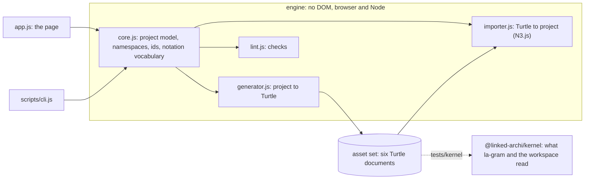

# Design: Metamodel Studio

## Overview

The project file is the editable source. The generator writes the asset set from it; the importer reads any
Linked.Archi documents back into a project. The kernel checks close the loop: they load a generated set the way
la-gram does and compare what the kernel reads with the project.

## Key design decisions

- **SD-1 One engine for the browser and the command line.** The engine modules are UMD and have no DOM, so the
  CLI, the tests and the page run the same code.
- **SD-2 Notation names in the project, core-vis IRIs in the documents.** The project stores the studio's names
  (`rounded-rectangle`, `dashed`, `open`); `core.js` maps them to core-vis individuals both ways.
  - **Everything visual is on the descriptor's `arch-vis:Style`:** shape, colours and, for a relationship type, its
    line style and both line ends.
  - **Why the style.** core-vis gives the colours `rdfs:domain arch-vis:Style`. A relationship's colour therefore
    has to be on a style, and the kernel reads a relationship's line and ends from its style as well as from the
    descriptor. One place keeps the reading simple.
  - **Two line ends.** core-vis decorates each end (`sourceDecor`, `targetDecor`), and a diamond or a dot belongs at
    the source. A project's earlier `arrow` is its target end (SD-9).
- **SD-3 Figures core-vis does not draw are the notation's own shapes.** Cylinder and folder are built in: when an
  element uses one, the notation document declares it as `<prefix>not:Cylinder` or `<prefix>not:Folder`, with a
  core fallback and path templates. A project may define more (`project.shapes`), and import keeps the own shapes
  of a published notation. This is how the C4 notation declares its cylinder and the ArchiMate 4.0 notation its
  folder; la-gram draws them, or their fallback.
- **SD-4 Proposal orders are ordered collections named from the manifest.** Each is a `skos:OrderedCollection` in
  the taxonomy document, and the manifest names each with `arch:relationshipProposalOrder` (core 0.6.0). The
  general order has no `arch:domainIncludes` or `arch:rangeIncludes`. A project holds any number
  (`project.proposalOrders`), with ids in the taxonomy namespace.
- **SD-5 The taxonomy document is a plain concept scheme.** The workspace's ontology conventions say a taxonomy is
  never an `owl:Ontology`, and no published taxonomy is. Its metadata goes on the scheme: `vann:`, `dct:` and
  `owl:versionInfo`, which is an annotation property; no `owl:imports` or `owl:versionIRI`.
- **SD-6 Fixtures are byte-identical copies of published documents.** `npm run fixtures` copies them from the
  installed `@linked-archi/kernel` package, whose `assets/` are byte-identical to meta.linked.archi;
  `npm run fixtures -- --check` compares them. The fixtures are committed, so CI, the Python tests and
  `npm run templates` need neither the kernel nor the network.
- **SD-7 The kernel checks are a development dependency.** `tests/kernel/` uses Vitest and the kernel's tarball.
  The page, the CLI and `npm test` stay dependency-free. The checks run locally until the kernel is published (K02),
  because CI cannot reach the tarball.
- **SD-8 One N3.js file for the browser and Node.** `vendor/n3.min.js` is N3.js's browser bundle, a script that
  defines `N3`. The page loads it with a script tag. Under Node, `importer.js` evaluates the same file inside a
  function (`vm.runInThisContext`) and takes `N3` from it, so there is no global and no install.
- **SD-9 Earlier files stay readable.**
  - `core.normalize` migrates format `/1` project files: `proposalOrder` becomes one general order, and a
    relationship style's `arrow` becomes its `target`.
  - The importer also reads the studio's earlier notation terms (`archvis:shape`, `archvis:arrowHead`, literal line
    styles) and `arch:RelationshipProposalOrder`.
- **SD-10 Project format `/2`.** It adds `proposalOrders`, relationship styles with `source` and `target`,
  `shapes`, and `meta.notationSetName`. The notation set's name is kept from an import, so a published set keeps
  its IRI, for example `am4not:ArchiMate40StandardNotation`.
- **SD-11 The repository is on GitLab, mirrored to GitHub.** From 2026-11-22 it is a public project beside la-gram,
  `linked-archi/linked-archi-tools/modellers/metamodel-studio`. GitHub keeps a copy for visibility.
  - **The engine lives here.** It becomes `packages/engine` in this repository, and the page is its first user. It
    moves to a repository of its own only if it needs to (PD-16, A2).
  - **It is published where the kernel is:** this project's GitLab package registry, as the kernel publishes to its
    own (PD-14). The pipeline publishes with its job token. If the kernel's project is private, the same token
    installs the kernel, once that project allows this one. No GitLab token is kept on another platform.
  - **Why not GitHub.** The engine's users and its contract are on GitLab: the kernel, the workspace (W08), the
    platform (F05) and la-gram. From GitHub, every publish to GitLab's registry would need a long-lived GitLab token
    in GitHub's secrets, and GitHub Packages needs a token even to install a public package. The GitHub repository
    had no stars, forks or issues, so moving cost little.
  - **Not in the `linked-archi-platform` group**, although the folder here is `tools/platform/`. That group is
    private, and GitLab allows no public project in a private group.
  - **The mirror is one-way.** GitLab pushes to GitHub. Changes, issues and merge requests are made on GitLab, and
    the GitHub copy has its issues turned off. It runs no GitHub Actions and serves no GitHub Pages.
  - **The page is served beside la-gram,** at `https://app.linked.archi/metamodel-studio/`. This project's
    pipeline copies it there over SSH, as la-gram's copies la-gram, and it runs under the site's headers, la-gram's
    Content-Security-Policy included (README, *Deploying*).

## Open questions

| Question | Where it is decided |
|---|---|
| The engine as a shared TypeScript package | A2, once platform decision PD-16 (proposed 2026-11-22) is accepted. Where it lives and is published: SD-11 |
| Installing from GitLab's package registry with npm 12, which by default refuses the tarballs its instance and group endpoints give (`EALLOWREMOTE`, gitlab-org/gitlab#605970). The project endpoint should avoid it; not yet tried | A2, when the engine is first published; the kernel meets it too |
| Previewing an imported own shape from its path templates (now: its fallback) | A2 |
| What import drops from published sets: icons, alternative styles, rendering modes, presentation contexts, palette grouping, diagram group order, element and principle shapes, relationship tables | A2–A4, as the workspace needs them |
| A cylinder among core-vis's shapes | linked-archi-meta; nothing here waits for it |
