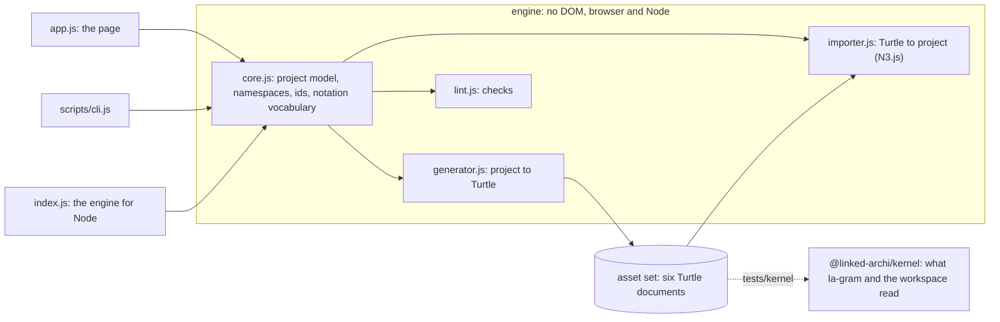

# Design: Metamodel Studio

## Overview

The project file is the editable source. The generator writes the asset set from it; the importer reads any
Linked.Archi documents back into a project. The kernel checks close the loop: they load a generated set the way
la-gram does and compare what the kernel reads with the project.

Each release carries the page, the command line and the engine as packages, and the demo runs on GitHub Pages
(SD-19).

## Key design decisions

- **SD-1 One engine for the browser and the command line.** The engine modules are UMD and have no DOM, so the
  CLI, the tests and the page run the same code.
- **SD-2 Notation names in the project, core-vis IRIs in the documents.** The project stores the studio's names
  (`rounded-rectangle`, `dashed`, `open`); `core.js` maps them to core-vis individuals both ways.
  - **Everything visual is on the descriptor's `arch-vis:Style`:** shape, colours and, for a relationship type, its
    line style and both line ends.
  - **Why the style.** core-vis gives the colours `rdfs:domain arch-vis:Style`. A relationship's colour therefore
    has to be on a style, and the kernel reads a relationship's line and ends from its style as well as from the
    descriptor. One place keeps the reading simple.
  - **Two line ends.** core-vis decorates each end (`sourceDecor`, `targetDecor`), and a diamond or a dot belongs at
    the source. A project's earlier `arrow` is its target end (SD-9).
- **SD-3 Figures core-vis does not draw are the notation's own shapes.** Cylinder and folder are built in: when an
  element uses one, the notation document declares it as `<prefix>not:Cylinder` or `<prefix>not:Folder`, with a
  core fallback and path templates. A project may define more (`project.shapes`), and import keeps the own shapes
  of a published notation. This is how the C4 notation declares its cylinder and the ArchiMate 4.0 notation its
  folder; la-gram draws them, or their fallback.
- **SD-4 Proposal orders are ordered collections named from the manifest.** Each is a `skos:OrderedCollection` in
  the taxonomy document, and the manifest names each with `arch:relationshipProposalOrder` (core 0.6.0). The
  general order has no `arch:domainIncludes` or `arch:rangeIncludes`. A project holds any number
  (`project.proposalOrders`), with ids in the taxonomy namespace.
- **SD-5 The taxonomy document is a plain concept scheme.** The workspace's ontology conventions say a taxonomy is
  never an `owl:Ontology`, and no published taxonomy is. Its metadata goes on the scheme: `vann:`, `dct:` and
  `owl:versionInfo`, which is an annotation property; no `owl:imports` or `owl:versionIRI`.
- **SD-6 Fixtures are byte-identical copies of published documents.** `npm run fixtures` copies them from the
  installed `@linked-archi/kernel` package, whose `assets/` are byte-identical to meta.linked.archi;
  `npm run fixtures -- --check` compares them. The fixtures are committed, so CI, the Python tests and
  `npm run templates` need neither the kernel nor the network.
- **SD-7 The kernel checks are a development dependency.** `tests/kernel/` uses Vitest and the kernel's tarball.
  The page, the CLI and `npm test` stay dependency-free. The checks run locally until the kernel is published (K02),
  because CI cannot reach the tarball.
- **SD-8 One N3.js file for the browser and Node.** `vendor/n3.min.js` is N3.js's browser bundle, a script that
  defines `N3`. The page loads it with a script tag. Under Node, `importer.js` evaluates the same file inside a
  function (`vm.runInThisContext`) and takes `N3` from it, so there is no global and no install.
- **SD-9 Earlier files stay readable.**
  - `core.normalize` migrates format `/1` project files: `proposalOrder` becomes one general order, and a
    relationship style's `arrow` becomes its `target`.
  - The importer also reads the studio's earlier notation terms (`archvis:shape`, `archvis:arrowHead`, literal line
    styles) and `arch:RelationshipProposalOrder`.
- **SD-10 Project format `/2`.** It adds `proposalOrders`, relationship styles with `source` and `target`,
  `shapes`, and `meta.notationSetName`. The notation set's name is kept from an import, so a published set keeps
  its IRI, for example `am4not:ArchiMate40StandardNotation`.
- **SD-11 The repository stays on GitHub.** It is public at `github.com/linked-archi/metamodel-studio`, with its
  issues, pull requests, CI, releases and demo (SD-19). Decision confirmed on 2026-11-25. A move to GitLab, decided
  on 2026-11-22, was dropped before it was made: its project had not been created, and the studio had begun to
  release and run its demo from GitHub. The pipeline written for the move, with its deploy beside la-gram, is
  removed.
  - **The engine lives here.** It becomes `packages/engine` in this repository, and the page is its first user. It
    moves to a repository of its own only if it needs to (PD-16, A2).
  - **Where the engine is published is open,** and decided with A2. Its users are on GitLab: the kernel, the
    workspace (W08), the platform (F05) and la-gram. GitHub Packages needs a token even to install a public
    package, and publishing to GitLab's registry from here needs a long-lived GitLab token in GitHub's secrets.
    Until A2, each release carries the engine in the studio's npm package, installed from its address (SD-19).
  - **The page is served by GitHub Pages.** Serving it beside la-gram as well would need a deploy job here, with an
    SSH key in GitHub's secrets. Nothing asks for that yet.
  - **PD-16 still names the GitLab project** in its paragraph on where the engine lives. That paragraph changes
    with the platform's register.

- **SD-12 A tree row is an item under one parent.** An element type with two parents has two rows, and choosing one
  highlights the other (SReq 11.1).
  - **A gesture names the parent it is about.** Moving a row replaces that parent with the target, in its place;
    with Alt, the target is added; dropping on *Element* takes the parent away. A row's key is its parent row's key
    and its id, so the page can tell the rows of one item apart, keep the one chosen, and follow a row a key moved.
  - **A parent of another language is an anchor.** It heads the project's subtypes of it and takes drops, but it is
    not the project's to move.
  - **Why.** The tree used to list a type under its first parent only. In ArchiMate 4.0, 29 types have two parents,
    so the six domain types showed as empty roots.
- **SD-13 The match between a category and an abstract type is computed.** A category matches an abstract type when
  its concrete element types, its sub-categories' included, are exactly the type's concrete subtypes; it is close
  when they share at least two and three quarters of the two together (SReq 11.6).
  - **Why computed.** In ArchiMate 4.0, 16 of the 21 element categories hold exactly the subtypes of one abstract
    type: the taxonomy repeats the class hierarchy. Working the match out needs no field and no name for one, follows
    every rename, and judges by structure, as the kernel infers taxonomy dimensions by structure too. No name is
    compared.
  - **Offers come from exact matches only,** as they were before the change, so a near match never prompts a
    change. Classifying in a sub-category, or specializing a subtype, covers the broader offer.
  - **Beside the stated link.** Where a category names its type (SD-17), the page compares the members with that
    type, and the worked-out match only says when the members point at another.
- **SD-14 A category's order is written only when it has one of its own; the names are ArchiMate 4.0's.**
  - **The array** is `<Category>Order`, `iso-thes:superOrdinate` the category, its `skos:memberList` every narrower
    concept once, sub-categories first (SReq 4.4). The kernel reads it to order la-gram's palette.
  - **Why only where set.** The kernel lists a group with no array by name. Writing an array for every category
    would freeze into la-gram's palette whatever order an import happened to give.
  - **Names.** `<Category>Order`, `PaletteGrouping` and `DiagramGroupOrder` are the names the published ArchiMate 4.0
    taxonomy gives them, so importing it and generating it again gives the same IRIs. An imported palette grouping or
    diagram group order keeps its own id, label and notes, and an imported array its label.
  - **Two lists per category,** `categoryOrder` and `memberOrder`, because sub-categories and types live in two
    namespaces: renaming and deleting reach each through its scope.
  - **The top level** has no category to hold an order. It keeps the project's order, and the palette grouping says
    which dimension la-gram's palette is grouped by.
- **SD-15 Project format `/3`.** A category has `standsFor`, `categoryOrder`, `memberOrder` and `orderLabel`; the
  taxonomy has `paletteGrouping` and `diagramGroupOrder`. `core.normalize` migrates `/1` and `/2`. `standsFor` joined
  `/3` before `/3` was published, so the format did not change again.
- **SD-16 The page's trees are plain DOM, in `tree.js`, with la-gram's gestures.**
  - **Gestures.** A drag starts after the pointer moves a few pixels with the button down. The row under it says what
    a drop would do, or why not; a folded row it rests on unfolds; Escape stops it. Ctrl or Cmd and Shift choose
    several rows. These are the gestures of la-gram's model explorer. On a touch screen the list scrolls, and a
    row's menu moves it.
  - **One change, three ways.** Each drop target decides itself what a drop does, and the change is an engine
    function in `core.js`. A drag, a menu item and a key call the same function, so every drag has a menu and a key
    (principle 6).
  - **Why no framework.** The page runs from disk with no build (principle 4). Why the engine: the workspace's
    Administration screens need the same moves (PD-16).
  - **What a viewer folds,** the taxonomy's view and whether relations show are kept in the browser, not the project.
  - **The page's checks** (`tests/ui/`) drive Chrome or Playwright's Chromium through Playwright, a development
    dependency. They run locally, as the kernel checks do: the CI image has no browser.

- **SD-17 A category keeps the type it stands for.** `standsFor` is one element type, the project's or a base's, read
  from and written as `rdfs:seeAlso` from the category (SReq 4.6). Decision confirmed on 2026-11-25.
  - **Why.** The published ArchiMate 4.0 taxonomy states it ("linked via rdfs:seeAlso on each SKOS concept pointing
    to its corresponding OWL class"), and import dropped it. Keeping it makes the link explicit where a language
    publishes one, and round-trips the published set.
  - **Only an element type.** ArchiMate 4.0 also links two relationship categories to its strength collections with
    `rdfs:seeAlso`; those, and links to documents, stay out.
  - **What the kernel does with it.** It reads a concept with nothing under it that stands for a class as that
    class, and leaves abstract classes out of the palette. So an empty category that stands for a concrete type
    appears in la-gram as that type, and the checks say so.
  - **Renaming and deleting reach it:** it is a reference in the concept namespace (`SCOPES`).
- **SD-18 A base is shown, never stored or changed.** A project names the languages it extends by its imports, as
  before; the studio shows each one it has (SReq 12). Decision confirmed on 2026-11-25.
  - **Where a base comes from.** ArchiMate 4.0 is the studio's own template, built from the published documents.
    Any other is loaded from its documents and kept in that browser: its types, attributes and taxonomy, not its rules
    or viewpoints. The kernel bundles ArchiMate 3.2 and 4.0 and no other language a project extends today.
  - **How it is shown.** `core.withBases` adds a base's types to a copy of the project as outside concepts, named
    `prefix:id`, with their parents, definitions and categories. The page's trees, pages, pickers and relations read
    that copy; the generator and the project file never see it, and the checks only compare references with it.
  - **Read only.** A base type takes drops and makes subtypes; it is never dragged, renamed or deleted, and the
    project's types are not classified in a base's categories: they are shown in them through the base types they
    specialize.
  - **Why not stored.** Which base and which version a project is pinned to is A3's (`plan.md`). Until then, the
    imports say enough to find a base, and nothing new is written into the project.

- **SD-19 A demo on GitHub Pages, and the studio as packages on each release.** Asked for on 2026-11-25, when
  nothing served the page yet (SReq 10.4–10.6).
  - **As rdf2docs publishes.** `ci.yml` runs on every push and pull request. `release.yml` runs on a tag
    `v<major>.<minor>.<patch>`: it attaches both packages to a GitHub release, then calls `demo.yml`, which also
    runs by hand. A release made with the workflow's token starts no other workflow, so the demo is called, not
    triggered.
  - **Two packages.** The npm package `linked-archi-metamodel-studio` has the `la-studio` command, the engine for
    Node, and the page, which `la-studio serve` serves on the computer it runs on. `index.js` gives the page's
    `window.LAStudio` without its user interface. The page's zip opens from disk or on any static host. Both keep
    the names `package.json` already had. The engine's own package, its name and its registry are still A2's
    (SD-11).
  - **Installed from an address.** npm installs a tarball from its URL with no registry and no token, which is
    what GitHub Packages could not offer (SD-11). A release's files keep their address; the demo carries the
    latest release's.
  - **The version.** `package.json` holds the next release's, as rdf2docs' `gradle.properties` does, and a release
    builds at its tag's. Any other build is `<version>-dev.g<commit>`, so one file name never names two builds. The
    package is packed from a copy with that version, without the scripts and development dependencies: one of them
    names a tarball on the maintainer's computer.
  - **The same bytes.** npm packs reproducibly, and the zip is dated by its commit, so the copies `demo.yml`
    builds equal the files attached to the release.
  - **A link opens a starting point,** `?template=<key>`, so the demo can link to each example, and the Overview
    says where to start until the viewer hides it. A link never replaces a changed project without asking.
  - **`private` stays.** It keeps `npm publish` from putting the package on the public registry before a registry
    and a name are chosen. Installing from a tarball ignores it.

## Open questions

| Question | Where it is decided |
|---|---|
| The engine as a shared TypeScript package, and where it is published | A2: platform decision PD-16 was accepted on 2026-11-24. Where it is published is open (SD-11). Until then, each release carries it in the studio's npm package (SD-19) |
| Installing the kernel from GitLab's package registry with npm 12, which by default refuses the tarballs its instance and group endpoints give (`EALLOWREMOTE`, gitlab-org/gitlab#605970). The project endpoint should avoid it; not yet tried | When the kernel is published (K02) and the kernel checks install it from there |
| Previewing an imported own shape from its path templates (now: its fallback) | A2 |
| What import drops from published sets: icons, alternative styles, rendering modes, presentation contexts, element and principle shapes, relationship tables | A2–A4, as the workspace needs them |
| Pinning a base and its version in the project, and loading it from its IRI (SD-18) | A3 |
| Classifying the project's types in a base's categories, so that la-gram's palette puts them in the base's sections | A3, with the pinned base |
| Carrying more bases: ArchiMate 3.2's documents are in the kernel's assets; BPMN, C4, Backstage and LeanIX are not | As extensions of them are made; until then their documents are loaded in the browser |
| A cylinder among core-vis's shapes | linked-archi-meta; nothing here waits for it |
