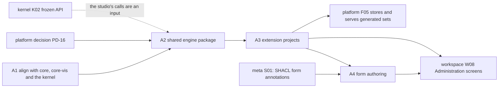

# Plan: Metamodel Studio

The studio becomes the metamodel authoring engine behind the workspace's Administration screens (agreed
2026-11-21; platform decision PD-16, proposed, in `linked-archi-platform/docs/decisions.md`). The platform's
`docs/plan.md` carries these steps as tickets A1–A4. Baseline: **21 November 2026**.

| Step | Work | Done when |
|---|---|---|
| **A1** | Notation in core-vis terms; proposal orders as core 0.6.0 defines them; the taxonomy as a plain concept scheme; `vann:` on every document; N3.js 2.13.12; fixtures copied from the kernel's assets; the ArchiMate 4.0 template from the published documents; the kernel checks | `npm run test:kernel` passes: the kernel reads every shape, line, line end and proposal order a project gives, and importing the published ArchiMate 4.0 keeps its 44 shapes and 9 proposal orders. `npm test` and the Python tests pass |
| **A2** | The engine as a TypeScript package, `packages/engine`, published to this project's GitLab package registry (SD-11); the importer and checks on the kernel; the page on the package. The package carries the moves, orders and relations the page's trees use (SReq 11), for the workspace's Administration screens | the studio's tests and the kernel checks pass on the package; the kernel calls it makes are listed for K02 |
| **A3** | Extension projects: a pinned base metamodel, only the additions generated | an extension adding one type and one field to LeanIX v4 loads beside LeanIX in la-gram with nothing reported incomplete |
| **A4** | What the workspace's forms need (after S01): SHACL property groups, field order and names, language-tagged ontology and taxonomy labels, link and nested fields, tags, roles, lifecycle | the workspace's fact sheet, or the kernel's form builder after K02, shows the sections and fields as authored |

The workspace's W01–W05 do not wait for this plan. W08 and F05 start after A3, and after A4 for fields that need
S01's terms. la-gram has one small task of its own: uploading several files at once, so a generated set loads in one
step.
